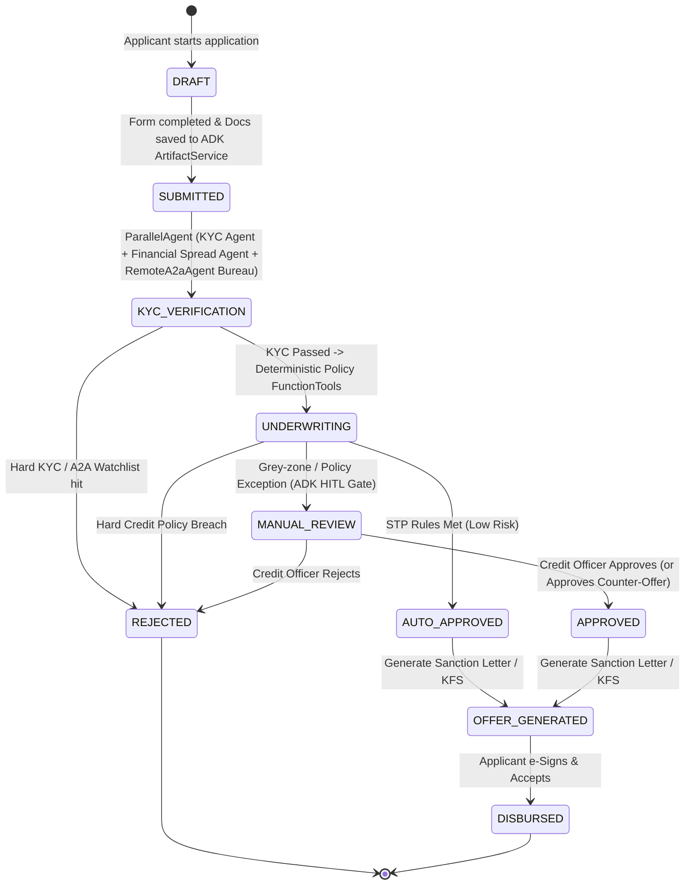

# Business Requirements Document (BRD): Retail & SME Loan Origination System (LOS)

| Document ID | Version | Status | Target Domain | Target Demo Scope |
| :--- | :--- | :--- | :--- | :--- |
| `BRD-LOS-2026-001` | 1.1 | Approved (ADK + A2A Spec) | Financial Services (Retail / SME Lending) | Multi-Agent ADK Pipeline, A2A Bureau Federation, KYC, Deterministic Policy & HITL Decisioning |

---

## 1. Executive Summary & Objective
Traditional loan origination suffers from high drop-off rates during document collection and slow manual underwriting cycles (3–7 days). This project implements an automated, AI-augmented **Loan Origination System (LOS)** for unsecured personal and micro-SME working capital loans powered by **Google Agent Development Kit (`google-adk`)**, **Google Gemini Agent Platform**, and the **Agent-to-Agent (`A2A`) protocol**.

**Primary Business Goals:**
- Reduce **Time-to-Yes (TTY)** from 5 days to `< 5 minutes` for Straight-Through Processing (STP) eligible applicants.
- Automate **Document Verification & Income Extraction** (Bank Statements, Tax Returns, ID Proof) with confidence scoring via multimodal Gemini agents.
- Demonstrate **Cross-Boundary Agent Federation via A2A (`Agent-to-Agent` Protocol)** by invoking an external **Credit Bureau & Fraud Consortium Agent** over A2A (`/.well-known/agent-card.json`) and exposing the LOS Underwriter Agent itself as an A2A service for Branch RM / Gemini Enterprise agents.
- Enforce deterministic **Credit Policy Rules** (`FunctionTool`s) alongside explainable AI risk summaries for credit officers on manual review cases.
- Maintain an immutable **Audit Trail** and enterprise governance via ADK Callbacks & Plugins (`BigQueryAgentAnalyticsPlugin`, Cloud Trace) for regulatory compliance (RBI Digital Lending Guidelines / Fair Lending).

---

## 2. Personas & Stakeholders

| Persona | Role | Key Actions |
| :--- | :--- | :--- |
| **Applicant (Borrower)** | Retail individual or SME owner applying for credit | Submits application, uploads KYC/financial docs, accepts loan offer. |
| **ADK Multi-Agent Underwriting Pipeline** | Orchestrated `SequentialAgent` + `ParallelAgent` hierarchy | Coordinates `kyc_fraud_agent`, `financial_spreading_agent`, remote A2A Bureau agent, deterministic policy tools, and `cam_synthesizer_agent`. |
| **External Credit Bureau & Watchlist Agent (A2A)** | Federated partner agent (`RemoteA2aAgent`) | Hosted across organizational/service boundaries; serves credit bureau tradelines, DPD history, and watchlist screening over the A2A protocol. |
| **Credit Officer (Underwriter)** | Human-in-the-loop (HITL) approver | Reviews grey-zone applications (`LongRunningFunctionTool` / HITL gate), simulates counter-offers, overrides soft rules with justification, approves/rejects. |
| **Risk & Compliance Auditor** | Governance & audit | Inspects ADK session event logs, callback audit trails, policy versions, and adverse action reasons. |

---

## 3. End-to-End Origination Workflow



---

## 4. Functional Requirements (FR)

### 4.1 Application Intake & Lead Capture
- **FR-01 (Loan Parameters):** Capture borrower profile (Full Name, DOB, PAN/Tax ID, Employment Type: Salaried vs. Self-Employed), requested loan amount (`$5,000` – `$100,000` or `₹1L` – `₹50L`), tenure (`12` – `60` months), and loan purpose into ADK `session.state`.
- **FR-02 (Document Upload & Artifacts):** Accept PDF/Image uploads and persist them via ADK `ArtifactService` (`InMemoryArtifactService` / `GcsArtifactService`) for:
  1. Government ID (PAN / Aadhaar / Passport)
  2. Latest 3 months' Salary Slips (Salaried) or ITR/GST returns (SME)
  3. Last 6 months' Bank Statements

### 4.2 KYC & Fraud Screening (`kyc_fraud_agent`)
- **FR-03 (Identity Extraction & Match):** Extract Name, DOB, and ID Number from uploaded ID documents and fuzzy-match against the application form (`>= 85%` similarity threshold).
- **FR-04 (Deduplication & Watchlist):** Check applicant against internal existing borrower records and a simulated sanctions/defaulter watchlist.

### 4.3 Document Intelligence & Financial Spreading (`financial_spreading_agent`)
- **FR-05 (Bank Statement Analysis):** Parse uploaded bank statements using Gemini structured outputs to calculate:
  - Average Monthly Balance (AMB)
  - Verified Monthly Net Income / Cash Inflow
  - Existing EMI outflows (debt obligations)
  - Dishonored checks / inward bounce counts
- **FR-06 (Tamper / Anomaly Detection):** Flag inconsistencies between declared income on the application form and verified income from documents (`> 10%` variance triggers manual review; `> 25%` triggers knockout).

### 4.4 A2A Credit Bureau Federation & Deterministic Underwriting Engine
- **FR-07 (Federated Credit Bureau Pull via A2A Protocol):** Invoke an external **Credit Bureau & Watchlist Agent** over the **Agent-to-Agent (`A2A`) protocol** (`RemoteA2aAgent` consuming `/.well-known/agent-card.json`) to fetch credit score (`300–900`), active trade lines, 30/60/90+ DPD (Days Past Due) delinquencies, and recent credit inquiries.
- **FR-08 (Financial Ratio Computation):** Deterministic ADK `FunctionTool` computes:
  - **FOIR (Fixed Obligation to Income Ratio):**
    $$\text{FOIR} = \frac{\text{Existing Monthly EMIs} + \text{Proposed Loan EMI}}{\text{Verified Monthly Net Income}}$$
- **FR-09 (Deterministic Decision Matrix):** Route applications into three buckets (`AUTO_APPROVED`, `MANUAL_REVIEW`, `REJECTED`) based on policy thresholds (see Section 5) stored in `tool_context.state`.
- **FR-10 (AI Credit Memo Generation - `cam_synthesizer_agent`):** Generate a structured Credit Assessment Memo (CAM) summarizing strengths, risk mitigants, red flags, and policy rule results for the Credit Officer.

### 4.5 Offer Generation & Sanctioning
- **FR-11 (Pricing & EMI Calculation):** Compute risk-based interest rate tier (`10.5%` to `18.0%` APR) and generate a Key Fact Statement (KFS) showing APR, processing fee (`1.5%`), and amortization schedule.
- **FR-12 (Adverse Action Notice):** If rejected, automatically record standardized, compliant rejection reason codes (e.g., `ERR_FOIR_EXCEEDED`, `ERR_BUREAU_SCORE_LOW`).

---

## 5. Credit Policy & Decisioning Rules (Demo Baseline)

| Rule ID | Metric | Auto-Approve (STP) | Manual Review (Grey Zone) | Auto-Reject (Knockout) |
| :--- | :--- | :--- | :--- | :--- |
| **POL-01** | **Applicant Age** | `23 – 60` years | `21 – 22` or `61 – 65` years | `< 21` or `> 65` years |
| **POL-02** | **Credit Bureau Score** | `>= 750` | `680 – 749` | `< 680` |
| **POL-03** | **FOIR (Post-Loan)** | `<= 45%` | `45.01% – 55%` (or Counter-Offer eligible) | `> 55%` (unmitigated) |
| **POL-04** | **90+ DPD (Last 24m)** | `0` instances | `0` instances (30-60 DPD allowed `<= 1`) | `>= 1` instance |
| **POL-05** | **Check Bounces (6m)** | `0` bounces | `1` technical bounce | `>= 2` bounces |
| **POL-06** | **Income Variance** | `<= 10%` vs declared | `10.01% – 25%` vs declared | `> 25%` or unverifiable |

> [!IMPORTANT]
> **Precedence Rule:** Any single **Auto-Reject** condition immediately rejects the loan (`REJECTED`), except when `POL-03` (FOIR `> 55%`) is the sole breach on an otherwise clean profile (`0` 90+ DPD, `0` bounces, Bureau `>= 680`) and the deterministic Counter-Offer optimizer finds a viable lower principal / extended tenure that brings projected FOIR `<= 48%`—routing the case to `MANUAL_REVIEW` with a recommended Counter-Offer. Only applications passing all **Auto-Approve** criteria achieve Straight-Through Processing (`AUTO_APPROVED`).

---

## 6. Google Gemini Agent Platform, ADK & A2A Showcase Capabilities

To make this demo a flagship showcase for Google Cloud Financial Services (FSI), the system explicitly highlights six core **Google Agent Development Kit (`google-adk`)** and **Gemini Agent Platform** capabilities:

| Platform Capability | How It Is Demonstrated in the LOS Demo |
| :--- | :--- |
| **1. Multi-Agent Workflow Orchestration (`SequentialAgent` & `ParallelAgent`)** | `los_orchestrator_agent` (`SequentialAgent`) runs `parallel_verification_stage` (`ParallelAgent` executing KYC, Financial Spreading, and A2A Bureau pull concurrently), followed by deterministic policy evaluation and `cam_synthesizer_agent`. |
| **2. Agent-to-Agent (`A2A`) Protocol (`RemoteA2aAgent` & `to_a2a`)** | **Outbound A2A:** The LOS orchestrator calls a federated **Credit Bureau & Fraud Consortium A2A Server** (`/.well-known/agent-card.json`).<br/>**Inbound A2A:** The LOS Underwriter Agent itself exposes an A2A Agent Card (`/a2a/los_underwriter/.well-known/agent-card.json`) so Branch RM agents or **Gemini Enterprise** can invoke it directly. |
| **3. ADK Deterministic Tooling & Shared Session State (`FunctionTool`, `ToolContext`)** | Financial calculations (`EMI`, `FOIR`, Counter-Offer optimizer) and `POL-01..06` policy checks run as deterministic `FunctionTool`s reading/writing typed keys in `tool_context.state`. |
| **4. Guardrails, PII Redaction & Audit Callbacks (`before_model_callback`, `after_tool_callback`)** | ADK callbacks & plugins enforce PAN/Account PII masking (`XXXXX1234F`) and append every tool/agent transition to an immutable regulatory audit trail. |
| **5. Human-in-the-Loop (HITL) Resumability (`ResumabilityConfig`, `require_confirmation`)** | Grey-zone applications (`MANUAL_REVIEW`) pause at the underwriter approval gate until the Credit Officer submits an `APPROVE`, `APPROVE_COUNTER`, or `REJECT` decision from the Underwriter Workbench. |
| **6. Gemini Platform Lifecycle (`agents-cli`, Agent Runtime, Agent Registry & Eval)** | Project supports `agents-cli eval` (trajectory & response evaluation), `agents-cli deploy` to **Agent Runtime** (`:streamQuery`) or **Cloud Run**, auto-registration in **Google Cloud Agent Registry**, and publishing to **Gemini** (`agents-cli publish gemini`). |

---

## 7. Core Data Model (Demo Implementation Schema)

```json
{
  "application_id": "LOS-2026-88412",
  "status": "MANUAL_REVIEW",
  "applicant": {
    "full_name": "Arjun Malhotra",
    "dob": "1991-04-15",
    "tax_id": "ABCDE1234F",
    "employment_type": "SALARIED",
    "declared_monthly_income": 120000
  },
  "loan_request": {
    "amount": 1500000,
    "tenure_months": 36,
    "purpose": "HOME_RENOVATION"
  },
  "underwriting_metrics": {
    "bureau_score": 732,
    "verified_monthly_income": 115000,
    "existing_emi_outflow": 18000,
    "proposed_emi": 49800,
    "foir_percentage": 58.95,
    "inward_bounces_6m": 0,
    "dpd_90_plus_24m": 0
  },
  "decision_audit": {
    "routing_outcome": "MANUAL_REVIEW",
    "triggered_rules": ["POL-02: Bureau 732 in review band", "POL-03: FOIR 58.95% exceeds 55% cap"],
    "ai_credit_memo": "Applicant has stable salaried income with 0 bounces, but requested loan of 15L pushes FOIR to 58.95%. Counter-offer recommended: Reduce loan amount to 11.5L or extend tenure to 48 months to bring FOIR under 50%.",
    "counter_offer": {
      "recommended_amount": 1150000,
      "recommended_tenure_months": 48,
      "projected_foir": 47.2
    }
  }
}
```

---

## 8. Non-Functional Requirements (NFR) & Demo Guardrails

1. **Deterministic Calculations:** LLMs must **never** perform arithmetic (EMI, FOIR, interest rates, rule thresholds). ADK `LlmAgent`s extract structured fields and synthesize the Credit Memo; deterministic Python `FunctionTool`s execute calculations and policy rules.
2. **Explainability & Auditability:** Every status change, A2A message exchange, and rule evaluation must log timestamp, input payload snapshot, rule version, and actor (`ADK_AGENT:<name>`, `A2A_REMOTE:<agent>`, or `CREDIT_OFFICER_ID`).
3. **PII Masking:** Tax IDs and account numbers must be masked in UI list views and observability traces (`XXXXX1234F`).
4. **Latency Targets:**
   - Bureau A2A call + Rule Engine evaluation: `< 2 seconds`
   - Parallel multimodal document extraction + AI Credit Memo synthesis: `< 15 seconds`

---

## 9. Suggested Demo Scope (MVP Architecture)

- **Frontend (React 19 / TypeScript / ShadCN / OKLCH):**
  - **View 1: Borrower Portal** — Quick application form + 1-click Persona Selector (`Clean STP`, `Grey-Zone Counter-Offer`, `Hard Knockout Reject`) + KFS & e-Sign acceptance.
  - **View 2: Underwriter Workbench** — Live ADK Agent & A2A Pipeline telemetry viewer, policy rule scorecard (Green/Amber/Red badges), AI Credit Memo, interactive Counter-Offer simulator, and 1-click Approve/Reject.
- **Backend (FastAPI + Google ADK `google-adk[a2a]` + Gemini):**
  - Root `SequentialAgent` + `ParallelAgent` multi-agent system with `Runner` & `InMemorySessionService` / `InMemoryArtifactService`.
  - Embedded & federation-ready **A2A Protocol** endpoints (`/a2a/credit_bureau/.well-known/agent-card.json` and `/a2a/los_underwriter/.well-known/agent-card.json`).
  - Real-time SSE event streaming of ADK `Event`s (`agent_start`, `a2a_call`, `tool_result`, `state_delta`) so the UI visualizes every agent handoff live.
